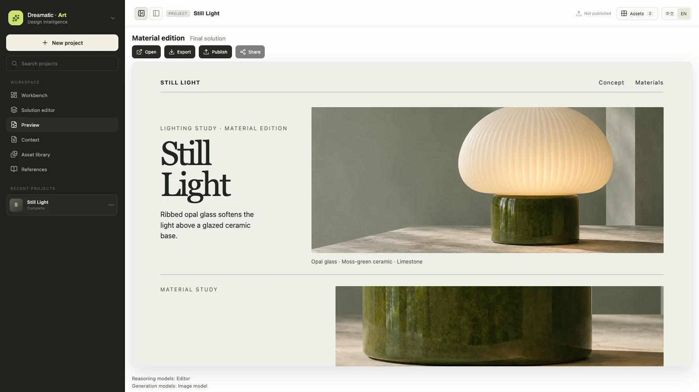
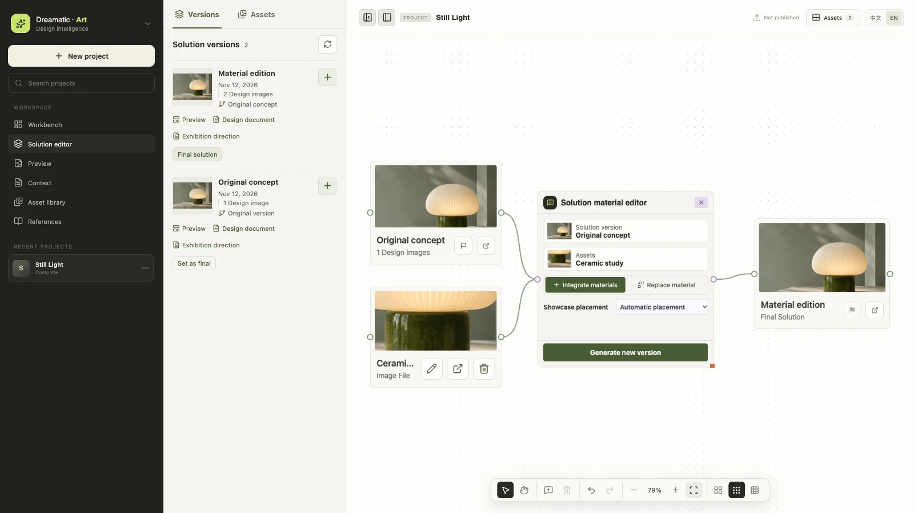
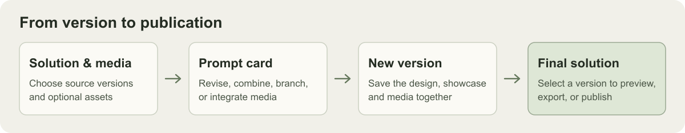

# Dreamatic · Art

**Preparing for v2.4.0**

Dreamatic · Art is an open-source, local-first AI design workbench for web and desktop. It turns a brief into research, design proposals, generated visuals, and static showcase pages. Project files and generated work live in a local workspace.

[Official website](https://www.dreamatic.art/) · [MIT license](LICENSE)



*The final solution in Preview, shown with the Still Light demo project.*

## What's new for v2.4.0

- **Versioned Solution Editor.** Drag a version onto the canvas and connect it to a prompt card to revise, combine, or branch designs. Each version keeps its own design document, showcase, and media, with links to its source versions.
- **Media integration.** Connect images or videos alongside a solution, then choose where to add them or select an existing asset to replace. The editor saves the result as a new version.
- **Showcase validation.** Builder checks the full media inventory before composing the page. Prompt cards retain action logs, validation feedback, elapsed time, and reported token usage.
- **Final selection and publishing.** Set the final solution from the version list or a canvas card. Project Preview opens that version, and you can export its ZIP or publish it to the DreamaticSite Gallery.





## Run from source

Use **Node.js 22.19 or newer** and npm.

```sh
git clone https://github.com/idvxlab/DreamaticArt.git
cd DreamaticArt
npm ci
cp .env.example .env
npm run build
npm start
```

Open **http://localhost:4310** and configure your reasoning and image providers in **Settings**. For environment-based setup, see [`.env.example`](.env.example). Project data is stored in `./workspace` by default. Set `DREAMATIC_WORKSPACE` to use another location.

For Electron, use `npm run desktop` on Apple Silicon macOS or `npm run desktop:win` on Windows x64.

## Development

- `npm run dev` starts the web UI and API.
- `npm run check` checks workspace types.
- After building, run `npm run test -w @dreamatic/server`, `node --test apps/web/test/*.test.mjs`, or `npm run desktop:test`.

## Documentation

- [Design pipeline, configuration, and recovery](apps/server/DESIGN-PIPELINE.md)
- [Design Skill policy and diagnostics](docs/SKILL-POLICY.md)
- [Frontend design system](docs/FRONTEND-DESIGN-SYSTEM.md)

Created by [Intelligent Design & Innovation Lab](https://idvxlab.com/).
