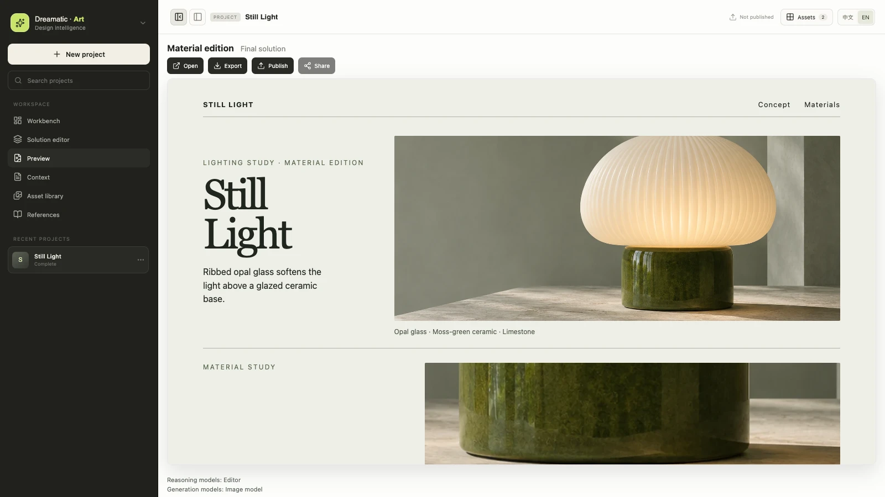
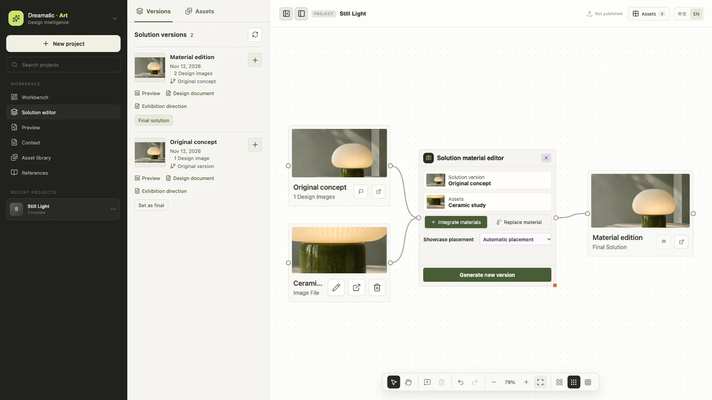
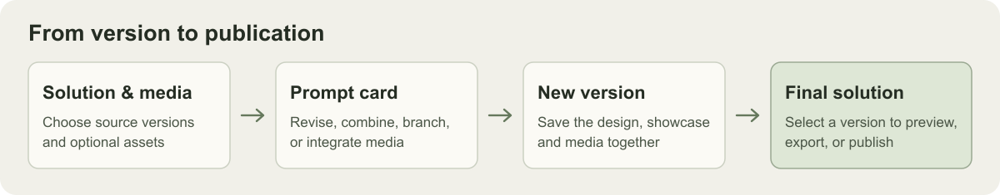

# Dreamatic · Art

**v2.4.2**

Dreamatic · Art is an open-source, local-first AI design workbench for web and desktop. It turns a brief into research, design proposals, generated visuals, and static showcase pages. Project files and generated work live in a local workspace.

[Official website](https://www.dreamatic.art/) · [MIT license](LICENSE)



*The final solution in Preview, shown with the Still Light demo project.*

## What's new in v2.4.2

- **Resume failed revisions.** Revision tasks retain checkpoints for accepted plans, completed images, exhibition directions, and validated showcases. Retrying the same task reuses valid results instead of repeating completed work. Checkpoints are validated before reuse and cleaned up after success.
- **More time for showcase generation.** Builder now has a dedicated generation allowance of 15 minutes per model response after its first output, configurable in Settings. Provider HTTP timeouts accommodate the configured response budgets; streaming idle and optional total response limits still apply.
- **Lean showcase context.** Builder receives a compact work inventory and can read the full design document when needed. A restored exhibition direction lets it proceed directly to composing the page.
- **Clearer recovery and errors.** Activity logs show restored plans, images, exhibition directions, and showcases, with Chinese translations. Failed model responses include provider error details alongside stream diagnostics.

## Previous updates in v2.4.1

- **Append-only editing.** Add content and new images while preserving the original design and media. Reused images inherit their source prompts and dimensions across revisions, fusion, and split outputs.
- **Faster revisions.** Single-image replacement submits only the target editing instruction and can reuse a validated showcase layout. Accepted plans proceed directly to image processing, reducing model calls and repeated context.
- **Intent-aware prompt cards.** Cards infer revise, append, recompose, fuse, split, or replace operations and ask for clarification when needed. Type `/` to choose from contextual commands. Card titles, instruction summaries, live progress, and dedicated cancel controls make tasks easier to follow.
- **Version-scoped context and assets.** Context and the asset library follow the final solution. In the Solution Editor, selecting a solution card shows its media; version references follow assets into subsequent edits. Shared project materials remain accessible.
- **Clearer questions and diagnostics.** The brief workflow asks about missing information that would significantly change the design or deliverables, with up to ten questions per card. Revision planning can retry once after a streaming idle timeout, and saved activity includes stream diagnostics and submission errors.

## Workbench features

- **Versioned Solution Editor.** Drag a version onto the canvas and connect it to a prompt card to revise, combine, or branch designs. Each version keeps its own design document, showcase, and media, with links to its source versions.
- **Media integration.** Connect images or videos alongside a solution, then choose where to add them or select an existing asset to replace. The editor saves the result as a new version.
- **Showcase validation.** Builder checks the full media inventory before composing the page. Prompt cards retain action logs, validation feedback, elapsed time, and reported token usage.
- **Final selection and publishing.** Set the final solution from the version list or a canvas card. Project Preview opens that version, and you can export its ZIP or publish it to the DreamaticSite Gallery.





## Run from source

Use **Node.js 22.19 or newer** and npm.

```sh
git clone https://github.com/idvxlab/DreamaticArt.git
cd DreamaticArt
npm ci
cp .env.example .env
npm run build
npm start
```

Open **http://localhost:4310** and configure your reasoning and image providers in **Settings**. For environment-based setup, see [`.env.example`](.env.example). Project data is stored in `./workspace` by default. Set `DREAMATIC_WORKSPACE` to use another location.

For Electron, use `npm run desktop` on Apple Silicon macOS or `npm run desktop:win` on Windows x64.

## Development

- `npm run dev` starts the web UI and API.
- `npm run check` checks workspace types.
- After building, run `npm run test -w @dreamatic/server`, `node --test apps/web/test/*.test.mjs`, or `npm run desktop:test`.

## Documentation

- [Design pipeline, configuration, and recovery](apps/server/DESIGN-PIPELINE.md)
- [Design Skill policy and diagnostics](docs/SKILL-POLICY.md)
- [Frontend design system](docs/FRONTEND-DESIGN-SYSTEM.md)

Created by [Intelligent Design & Innovation Lab](https://idvxlab.com/).
